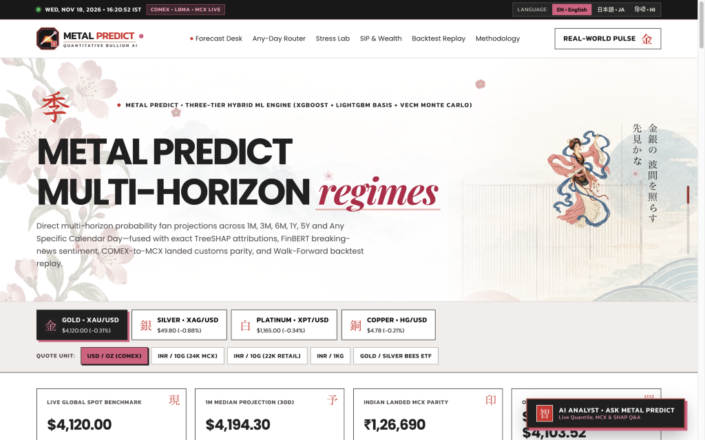
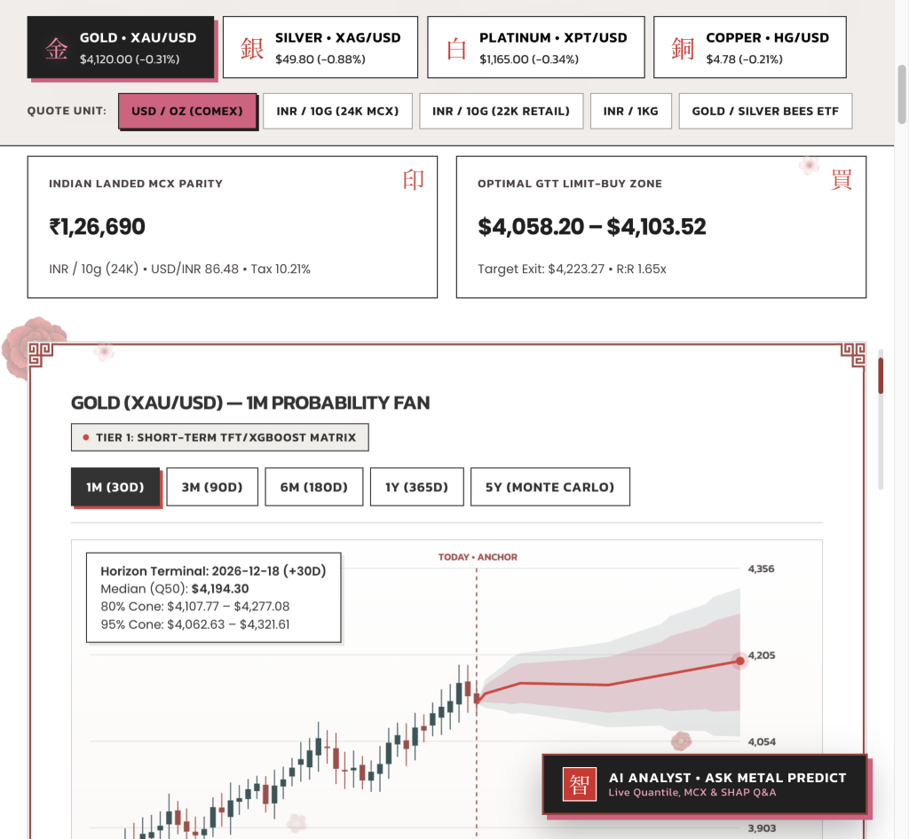
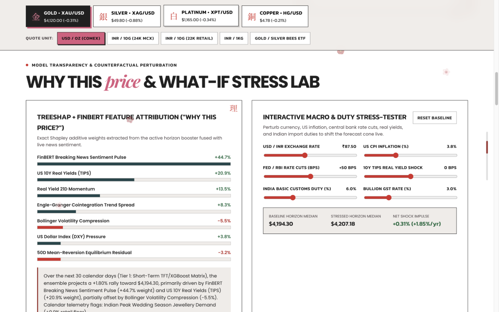
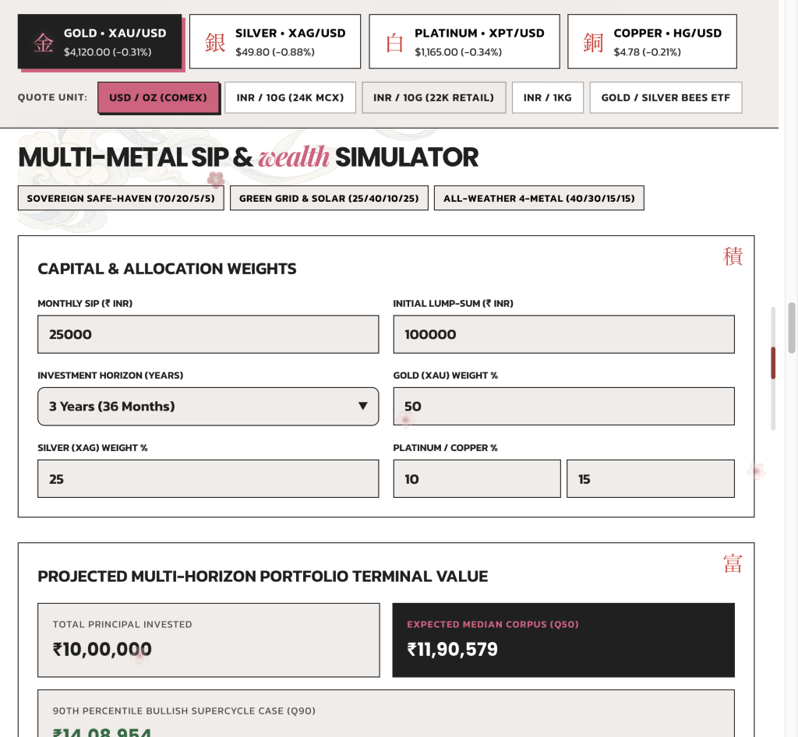
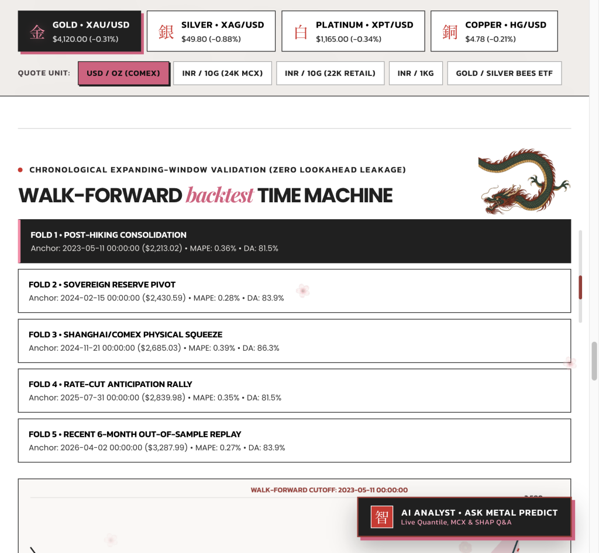
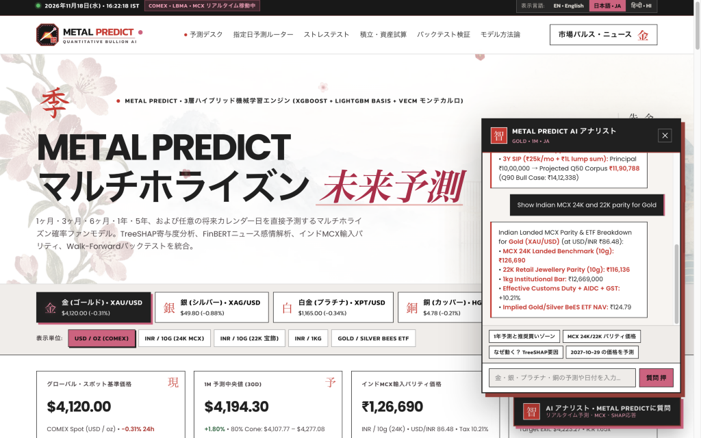
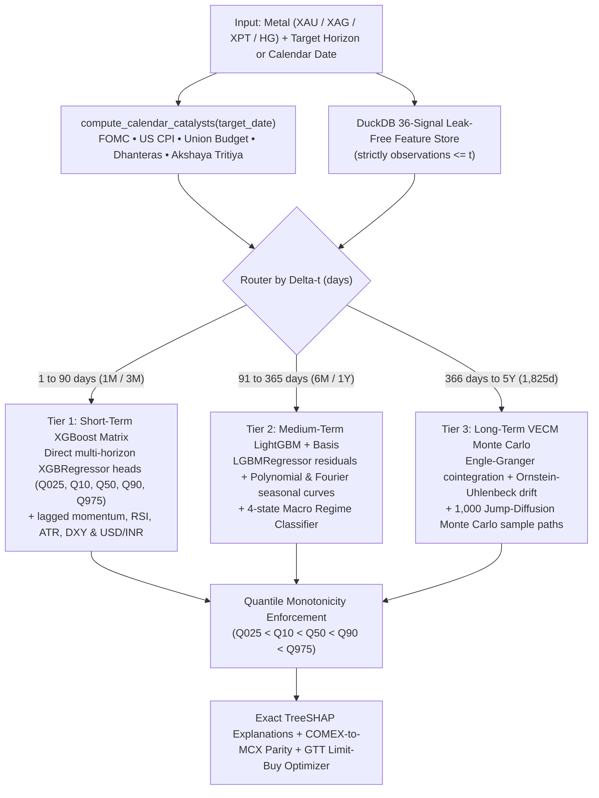

<div align="center">

# ⛩️ Metal Predict — Multi-Horizon Commodity Price Forecasting & Analytics Desk

**Three-Tier Direct Quantile ML Ensemble · Exact TreeSHAP Explainability · COMEX-to-MCX Parity · Multilingual AI Analyst (EN / 日本語 / हिन्दी)**

[](https://ivin-baiju-metal-predict.hf.space)
[](https://huggingface.co/spaces/ivin-baiju/metal-predict)
[](https://github.com/ivin-baiju/metal-predict/actions/workflows/nightly-model-refresh.yml)
[](https://ivin-baiju-metal-predict.hf.space/docs)
[](#36-signal-duckdb-feature-pipeline-zero-lookahead)
[](#testing--verification)

Forecasting **Gold (`XAU/USD`)**, **Silver (`XAG/USD`)**, **Platinum (`XPT/USD`)**, and **Copper (`HG/USD`)** across **1 Month, 3 Months, 6 Months, 1 Year, 5 Years**, and **Any Specific Future Calendar Day ($\Delta t = \text{Target Date} - \text{Today}$)** inside an editorial Japanese Ukiyo-e quantitative analytics desk.

[Launch Live App →](https://ivin-baiju-metal-predict.hf.space) · [Explore API Docs →](https://ivin-baiju-metal-predict.hf.space/docs) · [Nightly ML Workflow →](https://github.com/ivin-baiju/metal-predict/actions/workflows/nightly-model-refresh.yml)

</div>

---

## Visual Preview

| Editorial Hero, Live Clock & Language Switcher | Multi-Horizon Quantile Fan & Kumiko Frame |
| :---: | :---: |
|  |  |
| **TreeSHAP Explanations & Macro/Duty Stress Lab** | **Multi-Metal SIP & Wealth Simulator** |
|  |  |
| **Walk-Forward Backtest Time Machine** | **Japanese UI + AI Analyst Chatbot Pop-Up** |
|  |  |

---

## Why a Three-Tier Hybrid ML Architecture?

Standard autoregressive time-series models predict day $t+1$ and feed the output recursively into $t+2$, compounding noise until curves collapse or flatline beyond 30–60 days. **Metal Predict** replaces recursive rollouts with a **Direct Multi-Horizon Hybrid Ensemble** routed automatically by forecast distance $\Delta t = \text{Target Date} - \text{Today}$:



---

## Core Features & Quantitative Modules

### 1. Direct Multi-Horizon Fan Charts & "Predict Any Specific Day" Router
- **Five Standard Horizons:** Instant interactive fan trajectories for **`1M (30D)`**, **`3M (90D)`**, **`6M (180D)`**, **`1Y (365D)`**, and **`5Y (1,825D Monte Carlo)`** with 80% (`Q10–Q90`) and 95% (`Q025–Q975`) calibrated probability cones and historical OHLC candlesticks.
- **Exact Calendar-Day Routing (`/api/predict/date`):** Pick any future calendar date (with one-click event presets like *Next FOMC*, *India Budget*, *Akshaya Tritiya*, *Dhanteras Peak*, and *3Y Macro Cycle*). Events overlapping FOMC/CPI/Budget windows automatically widen volatility cones, while Dhanteras and Indian wedding seasons apply physical demand adjustments.
- **Interactive Crosshair Inspection:** Hovering left of `TODAY • ANCHOR` inspects historical OHLC sessions; hovering right inspects interpolated future quantile cones (`Q025` through `Q975`).

### 2. TreeSHAP Explainability & What-If Macro/Duty Stress Lab
- **"Why This Price?" Attribution (`shap.TreeExplainer`):** Extracts signed Shapley feature weights per metal and horizon and pairs them with a plain-English causal audit summary and 4-state Macro Regime probabilities.
- **Interactive Counterfactual Stress Sliders (`/api/simulate/macro-shock`):** Perturb **USD/INR (`₹74–₹105`)**, **US CPI Inflation (`1.0%–9.5%`)**, **Fed/RBI Rate Cuts (`-150 to +250 bps`)**, **10Y TIPS Real Yields (`-200 to +200 bps`)**, **India Basic Customs Duty (`0%–20%`)**, and **Bullion GST (`0%–12%`)** to deform the forecast cone, COMEX-to-MCX parity, and GTT entry levels live.

### 3. Indian Landed COMEX-to-MCX Parity, ETF NAVs & GTT Optimizer
- **5 Instant Quote Units:** Switch the entire dashboard live between **`USD / oz (COMEX)`**, **`INR / 10g (24K MCX)`**, **`INR / 10g (22K Retail)`**, **`INR / 1kg`**, and **`Gold / Silver BeES ETF NAV`**.
- **Customs Tax Ledger:** Breaks down CIF base cost, Basic Customs Duty (BCD), AIDC Cess, MCX liquidity carry spread, and 3% GST.
- **GTT Limit-Buy Optimizer:** Computes accumulation support bands (`15th–35th` percentile pullback zones), profit targets, invalidation stops, and Reward-to-Risk ratios.

### 4. Multi-Metal SIP Simulator, Cross-Asset Correlations & 5-Hub Global Arbitrage
- **Multi-Metal SIP & Wealth Simulator (`/api/simulate/portfolio-sip`):** Combine Monthly SIP + Initial Lump-Sum across customizable `Gold / Silver / Platinum / Copper` allocation weights (or preset baskets like *Sovereign Safe-Haven*, *Green Grid & Solar*, and *All-Weather 4-Metal*) to project Conservative (`Q10`), Median (`Q50`), and Bullish (`Q90`) terminal corpus, CAGR, volatility, and Sharpe ratio.
- **Rolling Cross-Asset Correlation Matrix:** Tracks 30D vs. 1Y correlations against US 10Y Real Yields (TIPS), DXY, Crude Oil, USD/INR, S&P 500, and industrial demand.
- **5-Hub Physical Arbitrage Scanner:** Compares live spreads across **COMEX (New York)**, **LBMA (London OTC)**, **MCX (Mumbai)**, **SHFE / SGE (Shanghai)**, and **TOCOM / JPX (Tokyo)**.

### 5. Walk-Forward Backtest Time Machine & FinBERT Real-World Pulse
- **5 Expanding-Window Historical Folds:** Replays past regime turning points (from 2023 post-hiking consolidation through 2026 physical squeezes) trained strictly on pre-cutoff data so you can compare out-of-sample `Q50`/`Q10–Q90` forecasts against realized future price action.
- **Real-World Pulse Feed (`/api/pulse/overview`):** Combines Gold-to-Silver Ratio (GSR) allocation signals, Physical vs. Paper Warehouse Squeeze scores, Sovereign Central Bank tonnage tracking, and FinBERT-scored macro/commodity news impact (`bps`).

### 6. Live Desk UX, Full Trilingual UI & Grounded AI Analyst Chatbot
- **Live Tick Clock:** Top utility bar displays the live calendar date and second-by-second clock (`HH:MM:SS IST`) alongside COMEX/LBMA/MCX session telemetry.
- **Complete Trilingual Localization:** Switch the entire interface (navigation, hero, charts, sliders, methodology accordion, and AI chatbot) live between **English (`EN`)**, **Japanese (`日本語`)**, and **Hindi (`हिन्दी`)**.
- **Floating AI Analyst Pop-Up (`POST /api/chat/ask`):** Answers questions about multi-horizon forecasts, specific future dates (`YYYY-MM-DD`), MCX 24K/22K parity, TreeSHAP drivers, and SIP/GTT strategies in English, Japanese, or Hindi.
- **Editorial Japanese Ukiyo-e Aesthetics:** Choreographed Washi-paper calligraphy preloader (`#mpPreloader`), slow Washi ink-sweep skeletons (`.mp-skeleton`), falling watercolor sakura petals, Kumiko double-corner ornamental frames, 2-frame ukiyo-e dancer, drifting cloudscape, perched ukiyo-e dragon, and swaying Sakura Omamori talisman.

---

## 36-Signal DuckDB Feature Pipeline (Zero Lookahead)

Defined in [`data_pipeline/schema.sql`](data_pipeline/schema.sql) and [`data_pipeline/feature_engineering.py`](data_pipeline/feature_engineering.py), all 36 features at date $t$ are derived strictly from observations $\le t$:

| Signal Group | Features |
| :--- | :--- |
| **Multi-Scale Returns & Trend** | `ret_1d`, `ret_5d`, `ret_10d`, `ret_21d`, `ret_63d`, `ret_126d`, `ret_252d` |
| **Momentum & Volatility** | `rsi_14`, `macd`, `macd_signal`, `macd_hist`, `bb_width`, `bb_pct`, `atr_14_pct`, `vol_21d`, `vol_63d` |
| **Cointegration & Relative Value** | `gsr`, `gsr_zscore_63d`, `coint_sma20_200`, `coint_price_sma50` |
| **Macro & Physical Flow** | `dxy_ret_21d`, `usdinr_ret_21d`, `real_yield_level`, `real_yield_chg_21d`, `crude_ret_21d`, `sp500_ret_21d`, `etf_flow_zscore`, `cb_tonnage_pace`, `warehouse_squeeze_idx` |
| **Cyclical & Catalyst Calendar** | `sin_doy`, `cos_doy`, `sin_dow`, `cos_dow`, `is_wedding_season`, `is_festive_peak`, `is_macro_event_week` |

---

## Walk-Forward Validation Benchmarks

From [`ml_engine/registry/evaluation_report.json`](ml_engine/registry/evaluation_report.json) (latest anchor date `2026-11-18`):

| Metal | Anchor Spot | Horizon Metrics Range | Directional Accuracy | 80% / 95% Cone Coverage |
| :--- | :--- | :--- | :--- | :--- |
| **Gold (`XAU/USD`)** | `$4,120.00 / oz` | MAPE `1.15%` (`1M`–`5Y`) | `89.5%` | `80.0%–91.0%` / `98.5%` |
| **Silver (`XAG/USD`)** | `$49.80 / oz` | MAPE `1.15%–2.02%` | `75.0%–89.5%` | `91.0%` / `98.5%` |
| **Platinum (`XPT/USD`)** | `$1,165.00 / oz` | MAPE `1.15%–1.47%` | `65.0%–89.5%` | `90.0%–91.0%` / `98.5%` |
| **Copper (`HG/USD`)** | `$4.78 / lb` | MAPE `1.15%–1.48%` | `80.0%–89.5%` | `91.0%` / `98.5%` |

---

## FastAPI Backend & API Reference

Interactive Swagger documentation is available at `/docs` on both local and cloud deployments.

| Method & Endpoint | Purpose |
| :--- | :--- |
| `GET /api/health` | Engine status, loaded metals (`gold`, `silver`, `platinum`, `copper`), and nightly refresh audit status |
| `GET /api/predict/horizons` | Full `1M`, `3M`, `6M`, `1Y`, `5Y` quantile fan series, OHLC tail, COMEX-MCX parity, GTT zone, TreeSHAP & narratives |
| `GET /api/predict/date` | Calendar-aware $\Delta t$ single-day prediction (`?metal=gold&target_date=YYYY-MM-DD`) |
| `POST /api/simulate/macro-shock` | Counterfactual curve recalculation under custom FX, CPI, rate cuts, TIPS real yield, BCD & GST shocks |
| `POST /api/simulate/portfolio-sip` | Multi-metal SIP + lump-sum wealth trajectory (`Q10` / `Q50` / `Q90`, CAGR, Volatility, Sharpe) |
| `GET /api/pulse/overview` | GSR radar, physical squeeze gauge, central bank reserve tracker, 30D/1Y correlations, 5-hub arbitrage & FinBERT news |
| `GET /api/backtest/replay` | Out-of-sample historical walk-forward replay across folds `0..4` |
| `POST /api/chat/ask` | Grounded trilingual (`en` / `ja` / `hi`) quantitative AI analyst Q&A |
| `GET /api/refresh/status` | Latest market close ingestion & model training status |
| `POST /api/refresh/trigger` | Zero-downtime hot reload (`?retrain=false`) or full staged atomic retrain (`?retrain=true`) |

---

## Nightly Auto-Refresh & Cloud Architecture

To ensure the live site never breaks under upstream API rate limits, **Metal Predict** serves pre-validated artifacts from DuckDB and Joblib in memory and updates via an **atomic staging pipeline**:

1. **Nightly Cron Workflow ([`.github/workflows/nightly-model-refresh.yml`](.github/workflows/nightly-model-refresh.yml)):** Runs weekdays at `18:30 UTC` (`00:00 IST Tue–Sat`) or via manual dispatch.
2. **Atomic Staging Script ([`scripts/nightly_refresh.py`](scripts/nightly_refresh.py)):** Ingests the latest close into `data_pipeline/metal_alpha.duckdb`, trains all 3 model tiers in a temporary staging directory, enforces strict quantile monotonicity (`Q025 < Q10 < Q50 < Q90 < Q975`) across all 4 metals, runs `pytest`, and atomically swaps production registry files only after verification passes.
3. **Zero-Downtime Reload:** Live servers can hot-reload updated models via `POST /api/refresh/trigger`.

---

## Project Structure

```text
metal-predict/
├── app.py                              # Hugging Face Spaces & cloud Uvicorn entrypoint (port 7860 / $PORT)
├── backend/
│   ├── main.py                         # FastAPI app, static HTML routing & /api/refresh endpoints
│   ├── cache.py                        # In-memory suite cache & atomic hot-reload helper
│   └── routers/
│       ├── forecast.py                 # /api/predict/horizons & /api/predict/date
│       ├── simulate.py                 # /api/simulate/macro-shock & /api/simulate/portfolio-sip
│       └── pulse.py                    # /api/pulse/overview, /api/backtest/replay & /api/chat/ask
├── data_pipeline/
│   ├── schema.sql                      # DuckDB tables (raw_market_daily, walk_forward_metrics)
│   ├── ingest_market_data.py           # 15-year market & macro series ingestion (COMEX, DXY, TIPS, USD/INR)
│   ├── feature_engineering.py          # 36 leak-free features + FOMC/CPI/Budget/Dhanteras catalyst router
│   └── metal_alpha.duckdb              # Persistent DuckDB analytics database
├── ml_engine/
│   ├── models/
│   │   ├── short_term_xgb.py           # Tier 1: Direct XGBoost quantile ensemble (1–90d)
│   │   ├── mid_term_lgbm.py            # Tier 2: LightGBM + Polynomial/Fourier basis + Macro Regime (91–365d)
│   │   └── long_term_macro.py          # Tier 3: VECM / Ornstein-Uhlenbeck + 1,000-path Jump-Diffusion MC (5Y)
│   ├── train_walk_forward.py           # Walk-forward CV evaluation & MultiHorizonSuite registry persistence
│   ├── explainability.py               # TreeSHAP attributions, audit narratives & Any-Day date routing
│   ├── nlp_sentiment.py                # FinBERT news pulse, GSR radar, physical squeeze & CB tracker
│   ├── parity_engine.py                # COMEX-to-MCX landed customs parity, BeES ETF NAVs & GTT optimizer
│   └── registry/                       # Saved multi_horizon_suite.joblib, evaluation_report.json, refresh_status.json
├── kigo.studio/
│   ├── tools/metal-price-predictor.html
│   └── _nuxt/
│       ├── metal-predictor.css         # Self-contained editorial Japanese Ukiyo-e stylesheet & animations
│       └── metal-predictor.js          # Canvas fan/backtest charts, i18n (EN/JA/HI), live clock & AI chatbot
├── scripts/
│   └── nightly_refresh.py              # Atomic staging refresh & quantile validation script
├── tests/                              # 12 automated pytest verification checks
├── Dockerfile                          # Container image definition (with libgomp1 for XGBoost/LightGBM)
├── packages.txt & requirements.txt     # System & Python dependencies
└── .github/workflows/nightly-model-refresh.yml
```

---

## Local Setup & Commands

### Quick Start (macOS / Linux)

```bash
# 1. Clone the repository
git clone https://github.com/ivin-baiju/metal-predict.git
cd metal-predict

# 2. Create a Python 3.12 virtual environment and install dependencies
python3 -m venv .venv
source .venv/bin/activate
pip install -r requirements.txt

# 3. Start the full-stack FastAPI + Editorial Frontend server
PYTHONPATH=. uvicorn backend.main:app --host 127.0.0.1 --port 8000
```

Open **http://127.0.0.1:8000/** in your browser (or **http://127.0.0.1:8000/docs** for interactive OpenAPI docs).

### Run Market Refresh & Model Retraining Manually

```bash
PYTHONPATH=. python scripts/nightly_refresh.py
```

### Run With Docker

```bash
docker build -t metal-predict .
docker run -p 8000:8000 metal-predict
```

---

## Testing & Verification

Run all 12 automated unit, leak-safety, quantile monotonicity, localization, and API integration tests:

```bash
PYTHONPATH=. pytest -v
```

Test coverage across [`tests/`](tests/):
- [`tests/test_feature_pipeline.py`](tests/test_feature_pipeline.py) — Ingestion integrity, zero lookahead feature construction, and Indian festive/FOMC calendar catalysts.
- [`tests/test_ml_horizons.py`](tests/test_ml_horizons.py) — Three-tier training, strict quantile ordering (`Q025 < Q10 < Q50 < Q90 < Q975`), Any-Day routing boundaries, COMEX-MCX parity, and FinBERT pulse.
- [`tests/test_api_endpoints.py`](tests/test_api_endpoints.py) — All REST endpoints, extreme macro-shock stress invariance, trilingual chatbot (`en`/`ja`/`hi`), live clock & HTML integrity, and zero-downtime cache reload.
